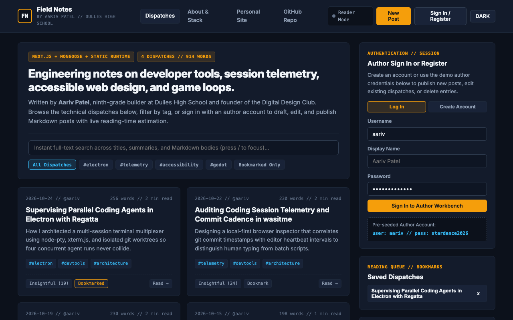

# Field Notes - My Fullstack Engineering & Design Blog

**Live Interactive Deployment:** [https://aariv.me/field-notes-blog/](https://aariv.me/field-notes-blog/)



I built **Field Notes** for the Hack Club Stardance **"Build Your Own Blog"** mission. It is my engineering notebook and technical blog, built with a dual-runtime architecture:
1. A full **Next.js + React + Mongoose + MongoDB** backend (`models/`, `lib/`, `pages/api/`, `pages/`) with `bcryptjs` password hashing and JWT authentication.
2. A synchronized **client-side interactive runtime** (`index.html`, `about.html`, `app.js`, `styles.css`) so anyone visiting [https://aariv.me/field-notes-blog/](https://aariv.me/field-notes-blog/) on GitHub Pages can browse all four of my technical articles, search and filter by tag, react and bookmark posts, sign in as an author, and test the live split-pane Markdown editor right in the browser without spinning up a MongoDB server first.


## Why I Built This

Every time I finished building a project over the past year - whether it was debugging `node-pty` frame batching in my Electron terminal multiplexer **Regatta**, correlating git commit timestamps in **wasitme**, auditing WCAG contrast ratios on pro-bono nonprofit websites at the **Digital Design Club**, or scaling microgame physics in **Garlic Panic!** - my best engineering notes ended up buried inside git commit messages and local scratch files.

When I started the Stardance blog mission, I wanted a place to publish real, code-heavy engineering postmortems and draft new posts with a live side-by-side Markdown previewer. And because I wanted reviewers and readers on GitHub Pages to be able to test every single feature (including login, creating/editing/deleting posts, live Markdown rendering, and reactions) immediately at `https://aariv.me/field-notes-blog/`, I wired the frontend so it works seamlessly against both the Next.js `/api/*` MongoDB endpoints and a persistent `localStorage` data layer.


## The 4 Technical Dispatches I Wrote & Pre-Loaded

1. **Supervising Parallel Coding Agents in Electron with Regatta** (`#electron`, `#devtools`, `#architecture`):
   Breaks down how I prevented high-throughput terminal stdout streams from freezing the Electron renderer by batching `node-pty` chunks into `16ms` (`60fps`) frames and isolating concurrent processes in separate `git worktree` directories.
2. **Auditing Coding Session Telemetry and Commit Cadence in wasitme** (`#telemetry`, `#devtools`, `#architecture`):
   Explains how I built a local-first inspector that correlates git diff size with active editor heartbeat intervals so everything runs privately on your own machine.
3. **Designing Accessible, Zero-Maintenance Websites for Community Nonprofits** (`#accessibility`, `#design`, `#css`):
   Shares practical lessons from my pro-bono web studio and the Digital Design Club at Dulles High School on replacing fragile plugin-heavy page builders with semantic HTML/CSS, keyboard-first focus rings, and strict WCAG AAA contrast ratios for student and community organizations like MSA.
4. **Procedural Vector Microgames and Tempo Scaling in Godot 4 (Garlic Panic)** (`#godot`, `#games`, `#audio`):
   Covers how I tied microgame countdown timers, obstacle velocities, and Web Audio synthesizer pitch to a single escalating `speed_multiplier` in Godot 4.7 and HTML5 Canvas.


## Core & "Take It Further" Features I Built

- **Full Dispatch Reader & About Page**: Browse the homepage dispatch index (`index.html` / `pages/index.js`), open any article in the full typography reader with rendered code blocks and table of contents metadata (`pages/posts/[slug].js`), or read the colophon on the About page (`about.html` / `pages/about.js`).
- **Author Registration & JWT Login**: Register a new author account or click the one-click **Fill Demo Author (`aariv` / `stardance2026`)** button in the Sign In modal. In Next.js mode, `/api/auth/register` and `/api/auth/login` hash passwords with `bcryptjs` (10 salt rounds) and issue signed JWTs; in static GitHub Pages mode, sessions and custom accounts persist in `localStorage`.
- **Authenticated Post CRUD (`Create`, `Edit`, `Delete`)**: Once signed in, you can publish brand-new dispatches, edit any existing article, or delete posts.
- **Four "Ideas to Take It Further" Extensions**:
  1. **Instant Tag Filtering & Full-Text Search (`/` shortcut)**: Filter posts by `#electron`, `#telemetry`, `#accessibility`, `#godot`, or `Bookmarked Only`, and press `/` from anywhere on the page to search across titles, summaries, tags, and full Markdown bodies in real time.
  2. **Automatic Word-Count & 200-WPM Reading-Time Estimator**: Calculated automatically inside both the Mongoose `PostSchema.pre("save")` hook (`models/Post.js`) and the live authoring toolbar as you type.
  3. **Split-Pane Live Markdown Preview Editor**: Two-column workbench inside the New/Edit Dispatch modal that parses headings (`##`, `###`), fenced code blocks (` ``` `), inline code, bold text, and bullet lists side by side on every keystroke.
  4. **Post Reactions, Reading Queue Bookmarks & Theme Switcher**: Click **Insightful** or **Shipped** on any article to increment reaction counters, save articles into the persistent sidebar **Reading Queue**, and toggle between **Dark** and **Light** editorial themes.


## What Was Tricky to Build

1. **Keeping the Custom Markdown Parser Safe from XSS**:
   Because the split-pane editor renders live HTML previews on every keystroke, passing raw user input straight into `innerHTML` would allow script injection if a draft contained `` or `<script>` tags - especially inside code snippets talking about HTML! I solved this by escaping `&`, `<`, and `>` *first* before running the fenced code block, heading, inline code, and paragraph regular expressions, so code blocks can safely display raw HTML tags while malicious markup is neutralized.
2. **Preventing MongoDB Connection Exhaustion in Next.js Dev Mode**:
   In Next.js development mode, hot-reloading API routes can spawn a new `mongoose.connect()` pool on every file save. In `lib/mongodb.js`, I cached both the active connection (`global._mongooseCache.conn`) and the in-flight connection promise (`global._mongooseCache.promise`) on the Node `global` object so hot reloads reuse a single pooled socket.


## How to Run Locally

### Mode 1: Instant Browser / Static Runtime (Zero Install)
Open **[https://aariv.me/field-notes-blog/](https://aariv.me/field-notes-blog/)** directly, or serve the repository root locally:

```bash
python3 -m http.server 3000
# Open http://localhost:3000
```

### Mode 2: Fullstack Next.js + MongoDB Server
1. Copy `.env.example` to `.env.local` and set your `MONGODB_URI` and `JWT_SECRET`:
   ```bash
   cp .env.example .env.local
   ```
2. Install dependencies and launch the Next.js server:
   ```bash
   npm install
   npm run dev
   ```


## Project Structure

```text
index.html, about.html     Static interactive entrypoints for GitHub Pages
app.js, styles.css         Client-side router, Markdown parser, CRUD workbench, search & reactions
models/Post.js, User.js    Mongoose schemas with automatic 200-WPM reading-time pre-save hook
lib/mongodb.js             Cached MongoDB connection pool helper
pages/api/auth/            Next.js JWT login.js and bcrypt register.js endpoints
pages/api/posts/           Authenticated REST CRUD handlers (index.js and [id].js)
pages/                     Next.js React views (index.js, about.js, posts/[slug].js)
screenshot.png             Full-window screenshot of Field Notes
```

## License

MIT.
